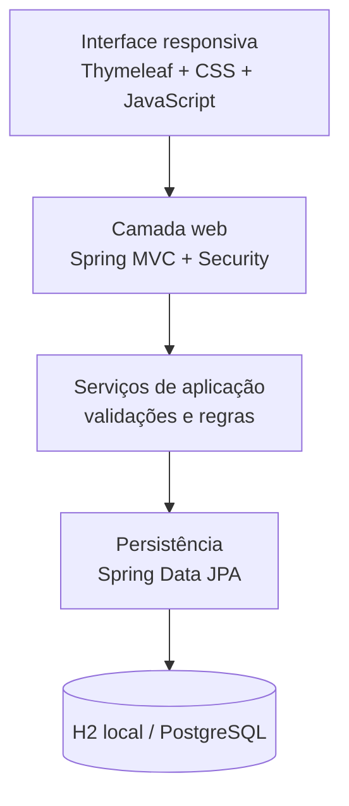
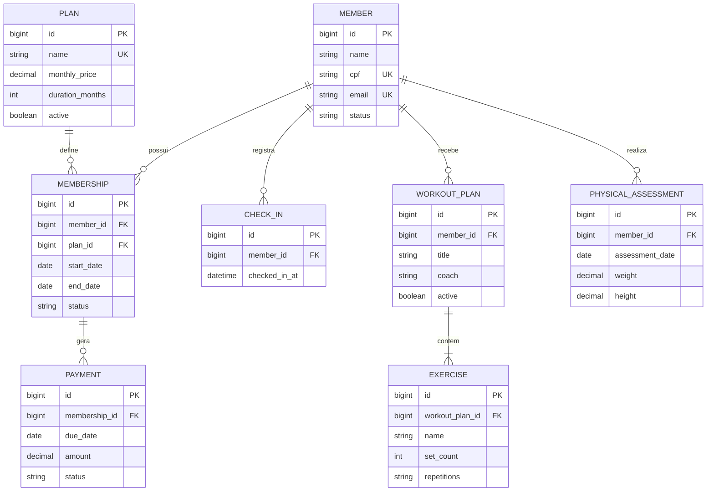

# Arquitetura do GymFlow

## Visão geral

O GymFlow é uma aplicação web modular em monólito. Cada domínio concentra suas entidades, formulários, repositórios, serviços e controladores. Essa organização mantém a implantação simples sem misturar as regras de alunos, cobranças, acesso e treino.

## Modelo de dados

## Regras centrais

- CPF é normalizado, validado pelos dígitos verificadores e mantido único.
- E-mail de aluno é único e comparado sem diferenciar maiúsculas de minúsculas.
- Uma nova matrícula calcula o valor líquido com desconto e gera as mensalidades do contrato.
- Uma matrícula anterior ativa é encerrada ao iniciar outra para o mesmo aluno.
- O pagamento registra data, forma e status; títulos vencidos são identificados pelo serviço financeiro.
- Check-in exige aluno ativo, matrícula vigente e ausência de outro check-in no mesmo dia.
- Fichas de treino preservam a ordem dos exercícios e permitem apenas uma ficha ativa por aluno.
- Avaliações calculam IMC a partir de peso e altura e mantêm o histórico corporal.

## Segurança

Todas as páginas, exceto login, ativos estáticos e health check, exigem autenticação. A senha é codificada com BCrypt em memória no início da aplicação e deve ser fornecida por variável de ambiente em produção. Formulários usam a proteção CSRF do Spring Security.

## Persistência

O banco local padrão é H2 em arquivo, útil para avaliação imediata. Em Docker, a aplicação usa PostgreSQL. O esquema é versionado com Flyway e validado pelo Hibernate durante a inicialização.

## Decisões operacionais

- `APP_DEMO_DATA=true` carrega um conjunto idempotente de dados fictícios somente quando a base está vazia.
- `APP_DEMO_DATA=false` inicia uma instalação limpa.
- `/actuator/health` permanece público para health checks; os demais endpoints de gerenciamento respeitam a autenticação.
- O pipeline executa compilação, testes unitários, teste de contexto e testes de autorização em Java 21.
